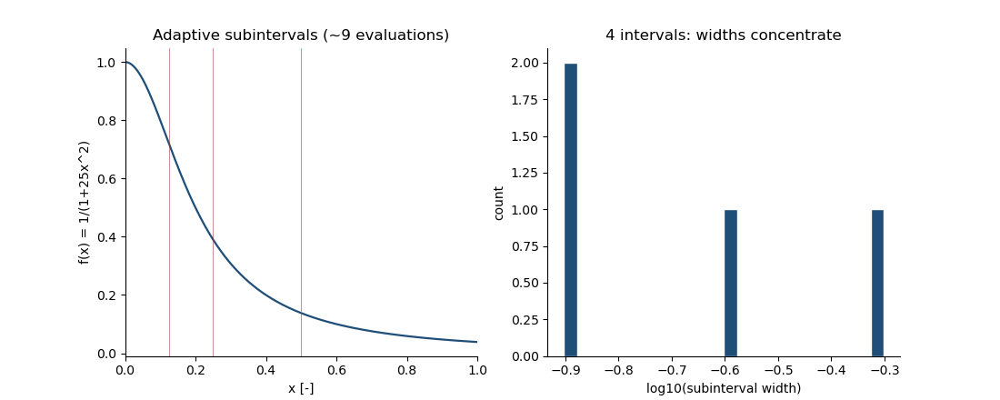

# 📐 Quadrature Workbench

**Adaptive error control and evaluation budgets: an original C++17 quadrature toolkit — adaptive Simpson with the classic |S2−S1|/15 Richardson estimator and honest termination statuses, composite Simpson pinned to cubic exactness (< 1e-14), and a bounded benchmark whose 51-row output is enforced by a regression that exists because a runaway loop once wrote a 25.5 GB CSV.**

[](https://github.com/khalil-official/quadrature-workbench/actions/workflows/ci.yml)
[](LICENSE)
[](CMakeLists.txt)

<div align="center">

**▶ Watch the mesh concentrate where the physics is hard:**



<sub>38 frames — each is the actual greedy-refinement partition of
f(x) = 1/(1+25x²) at that evaluation budget (interval with the largest
|S2−S1| splits next), with the subinterval-width histogram concentrating
toward the steep region near x = 0. Produced by
<code>examples/run_verification.py</code>.</sub>

</div>

## 🎯 Purpose and scope

Verification-first 1-D numerical integration: a small, dependency-free
C++ library exposing **composite** and **adaptive** Simpson quadrature
with an explicit tolerance contract, evaluation budgets, recursion-depth
limits, and a status code that separates *converged* from *partial*
results. The benchmark layer measures error-vs-evaluations against
closed-form references on a fixed, bounded parameter lattice. Scope:
finite, point-sampled integrands on finite intervals. Not a
Gauss–Kronrod/oscillatory/multidimensional engine — those are deliberate
scope cuts, not claims.

## 🧮 Model, method, and guarantees

- **Composite Simpson** (uniform grid, n even): O(h⁴) on C⁴ integrands,
  exact for cubics — pinned by test to < 1e-14.
- **Adaptive Simpson**: recursive bisection with the Richardson estimate
  |S2−S1|/15 and the per-interval criterion `|S2−S1|/15 ≤ atol + rtol·|S2|`.
  The reported `error_estimate` is a **heuristic aggregate, not a bound**;
  every accuracy claim in the results is measured against exact values.
- **Termination honesty**: budget or depth exhaustion returns
  `BUDGET_EXHAUSTED` / `MAX_DEPTH` with a partial value — never a silent
  `OK`. Non-finite samples stop refinement honestly.
- **Bounded output by construction**: the benchmark grid is 3 cases ×
  (5 tolerances + 12 grid sizes) = 51 rows; the driver enforces a row
  cap, checks every file operation, and the regression suite pins the
  exact count, valid parameter values, a 64 KiB size cap and a 120 s
  subprocess timeout.

Details: [docs/model.md](docs/model.md) · API: [docs/api.md](docs/api.md).

## ⚡ Quick start

```bash
cmake -S . -B build && cmake --build build
ctest --test-dir build --output-on-failure     # C++ gate (groups 1–7)

python -m pip install pytest                    # bounded-output regression
python -m pytest tests/test_bench_regression.py -q

python examples/run_verification.py             # figures + GIF + raw data
```

Verified: GCC 16.2.0 & C++17 on Windows 11 (Python 3.13.5), GCC 13 on
Ubuntu 24.04 CI. C++ gate < 1 s; regression ≈ 1 s; full results script
≈ 24 s.

## 🧱 Architecture and API

```
src/quadrature.{hpp,cpp}   # library: composite + adaptive Simpson, Status
src/bench.cpp              # qw_bench: bounded 51-row CSV driver, checked I/O
tests/test_quadrature.cpp  # CTest gate: exactness, honesty, validation
tests/test_bench_regression.py  # bounded-output + failed-open regression
examples/run_verification.py   # builds, gates, renders figures + GIF
docs/{model,api,verification}.md  docs/results/
```

```cpp
const auto r = qw::adaptive_simpson(f, 0.0, 1.0, /*atol*/1e-10,
                                    /*rtol*/1e-10, /*budget*/100000,
                                    /*depth*/50);
if (r.status == qw::Status::OK) use(r.value);
```

## 📊 Results and metrics

| Case (exact reference) | Metric | Measured |
| --- | --- | --- |
| ∫₀² (x³−2x+1) dx = 2 | composite n=8 error | **< 1e-14** (cubic exactness) |
| Runge 1/(1+25x²), tol=1e-11 | adaptive error / evals | **8.93e-11 / 285** |
| Runge, fixed n=64 | fixed error / evals | 2.61e-10 / 65 — *competitive: no adaptive-dominance claim on smooth cases* |
| Narrow Gaussian σ²=1e-6 | adaptive vs fixed | **81 vs 2049 evaluations** at ~1e-11 error (localized feature: the honest dominance case) |
| sin on [0,π] across the ladder | measured tolerance semantics | true error ≈ 0.3·tol (estimator-scaled, not a bound) |
| Benchmark output | rows / CSV size / runtime | **51 / 2.4 KB / 0.11 s** (was: runaway 25.5 GB before the regression existed) |

Raw grid: [docs/results/efficiency.csv](docs/results/efficiency.csv);
summary: [run_summary.json](docs/results/run_summary.json); stills
[efficiency.png](docs/results/efficiency.png) (·svg); animation
`refinement_progression.gif`.

## ✅ Verification

Three layers (see [docs/verification.md](docs/verification.md)): the C++
unit gate (exactness, tolerance hierarchy, exhaustion honesty, input
validation, ladder regression), the end-to-end bounded-output regression
with a hard subprocess timeout, and the reproducible results script.
CI: Ubuntu 24.04, GCC 13, warnings `-Wall -Wextra -Wpedantic`.

## 🛟 The 25.5 GB lesson

The first benchmark loop multiplied its tolerance **up** while requiring
a lower bound, so it never exited and wrote a 25,525,479,948-byte CSV
that filled the disk. The repaired ladder shrinks by 1e-2, and the
failure is now a permanent regression: exact row count, finite/valid
parameters, size cap, timeout, and a checked-I/O contract that exits
nonzero with `errno` diagnostics instead of writing through a null
`FILE*`. [docs/verification.md](docs/verification.md) reproduces the
argument; `tests/test_bench_regression.py` enforces it.

## ⚠️ Limitations

- `error_estimate` is the sum of accepted local heuristics — useful
  diagnostics, **not** a guaranteed error bound.
- Finite, point-sampled integrands only; undetected singularities
  between samples are outside the contract.
- Double precision: attainable error floors near 1e-13…1e-16; tolerances
  below that are estimator-only.
- 1-D finite intervals; no oscillatory/multidimensional transforms.

## 📚 References

- Stoer & Bulirsch, *Introduction to Numerical Analysis*, Ch. 3.
- Davis & Rabinowitz, *Methods of Numerical Integration*, 2nd ed.
- Gander & Gautschi, "Adaptive Quadrature — Revisited", BIT 40 (2000).

Tooling used for figures: NumPy (BSD-3), Matplotlib (PSF-based), Pillow
(HPND-CMU), pytest (MIT). This repository's own code is original and
MIT-licensed; see [LICENSE](LICENSE).
